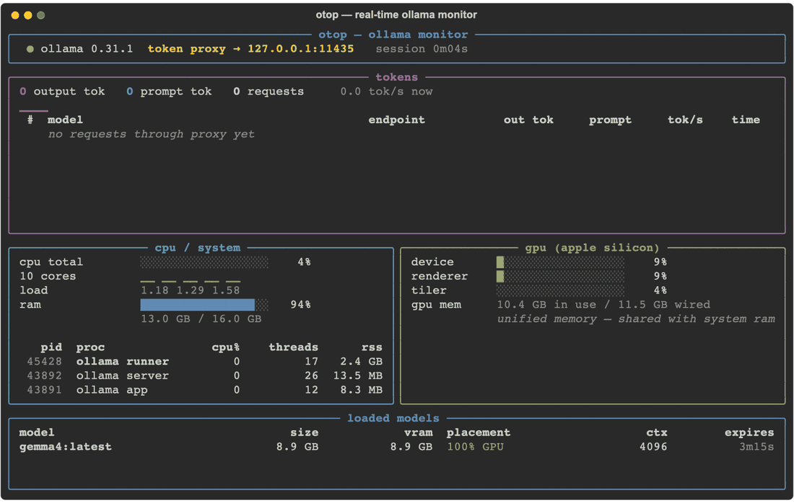
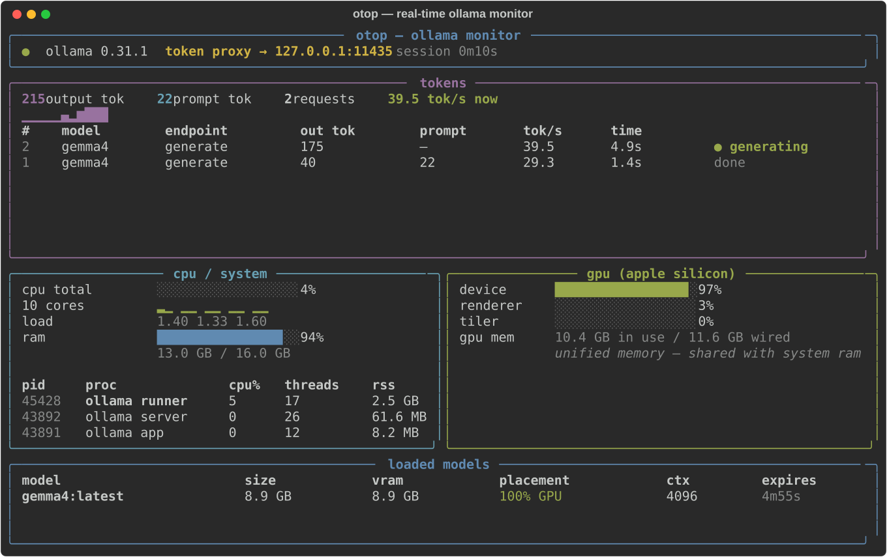

# otop — Real-Time Ollama Token Monitor (tokens/sec, CPU, GPU & VRAM in your terminal)

**otop** is an htop-style terminal dashboard for [Ollama](https://ollama.com) that shows
**live output token counts and tokens per second**, **CPU usage**, **threads**,
**GPU utilization**, **VRAM / unified memory**, and the **models currently loaded** —
all updating in real time while your local LLM generates.



*Real capture: gemma4 (8B) generating on an Apple M5 — output tokens climbing at
~39 tok/s, GPU at 97%, model 100% on GPU.*

## Features

- 🔢 **Live token tracking** — output tokens and prompt tokens counted *as they stream*,
  per-request tok/s, session totals, and a tok/s sparkline. Final numbers are reconciled
  against Ollama's own `eval_count`, so they're exact.
- ⚡ **Per-request table** — model, endpoint, output tokens, tokens/sec, elapsed time,
  and state (`generating`, `thinking/loading`, `done`).
- 🧠 **CPU & threads** — total and per-core CPU, load average, plus CPU%, **thread count**
  and memory of every Ollama process (server, model runner, menubar app).
- 🎮 **GPU monitoring on Apple Silicon** — device/renderer/tiler utilization % and GPU
  memory in use, read from `ioreg`. **No sudo required.**
- 📦 **Loaded models** — size, VRAM, GPU/CPU placement split, context length, and
  keep-alive expiry countdown (from `/api/ps`).
- 🪶 **Single file, no daemon** — one Python script using `rich`, `psutil`, `aiohttp`.
- 🔌 **Any OpenAI-compatible server** — llama.cpp, vLLM, LM Studio, Cline: point
  `--upstream http://host:port/v1` and otop counts its SSE streams too, injecting your
  API key (`--api-key`) on the way through.

## Quick start

```sh
git clone https://github.com/TiniLLM/ollama-token-monitor.git
cd ollama-token-monitor
./otop.sh
```

First run creates a local `.venv` and installs the three dependencies. Quit with `Ctrl-C`.

Or manually:

```sh
python3 -m venv .venv && .venv/bin/pip install -r requirements.txt
.venv/bin/python otop.py
```

## Getting live token counts

Ollama's API doesn't expose other clients' in-flight generations, so otop runs a
**transparent proxy on port 11435** that forwards everything to Ollama (11434) and counts
streamed tokens as they pass through. Point whatever you use at the proxy:

```sh
# ollama CLI
OLLAMA_HOST=127.0.0.1:11435 ollama run llama3.2

# curl / scripts (native Ollama API)
curl http://127.0.0.1:11435/api/generate -d '{"model":"llama3.2","prompt":"hello"}'

# OpenAI-compatible clients & SDKs
export OPENAI_BASE_URL=http://127.0.0.1:11435/v1
```

```python
# python (openai sdk)
from openai import OpenAI
client = OpenAI(base_url="http://127.0.0.1:11435/v1", api_key="ollama")
```

## Using otop with Cline (or any keyed OpenAI-compatible server)

otop also works as a counting proxy in front of a non-Ollama server — `llama-server`,
`vLLM`, `LM Studio`, or any OpenAI-compatible endpoint, including ones that need an API
key and live behind a path prefix such as `http://192.168.0.23:8080/v1`:

```sh
./otop.sh --upstream http://192.168.0.23:8080/v1 --api-key "$(cat key.txt)"
```

Then point Cline at the **proxy**, not at the upstream server:

```text
Provider settings → type: OpenAI-compatible
openaiBaseUrl = http://127.0.0.1:11435/v1
apiKey        = anything (otop injects the real key)
```

The proxy injects `--api-key` into every upstream request as `Authorization: Bearer …`
(`--api-key-header x-api-key` or `both` if your server wants that instead), and takes it
from `$OTOP_API_KEY` / `$OPENAI_API_KEY` when the flag is omitted. Cline's own key field
can therefore stay a placeholder — the real key never leaves your machine's otop process,
and every streamed response is still token-counted on the dashboard.

| otop flag | meaning |
|---|---|
| `--upstream URL` | where requests are forwarded to; may carry a path prefix (`…/v1`) |
| `--api-key KEY` | key injected upstream (falls back to `$OTOP_API_KEY` / `$OPENAI_API_KEY`) |
| `--api-key-header …` | `authorization` (default), `x-api-key`, or `both` |
| `--proxy-port PORT` | counting-proxy port (default 11435) |
| `--proxy-host HOST` | bind address (default 127.0.0.1) |

The header line tells you what is live: `● ollama v0.31 http://192.168.0.23:8080/v1 api key ✓ proxy :11435`
(or `● openai …` when only the OpenAI-compatible endpoints answered), `● 401 for /v1/models`
when the server answers but rejects the key, and `● upstream unreachable` when it can't be
reached at all.

All response formats are counted: native NDJSON streams (`/api/generate`, `/api/chat`),
OpenAI-style SSE (`/v1/chat/completions`, `/v1/completions`), and non-streaming responses —
even when a server labels its SSE stream `application/json` or gzips the body. Traffic sent
straight to the upstream still works normally; it just isn't token-counted, and the CPU,
GPU, and model panels work regardless.



## The panels, explained

| Panel | What it shows | Source |
|---|---|---|
| **tokens** | session output/prompt totals, live tok/s + sparkline, last requests with per-request tok/s and state | counted by the proxy, reconciled with `eval_count` / `usage` |
| **cpu / system** | total + per-core CPU, load average, RAM; CPU%, threads, RSS per Ollama process | `psutil` |
| **gpu (apple silicon)** | device / renderer / tiler utilization %, GPU memory in use vs wired | `ioreg -c IOAccelerator` (no sudo) |
| **loaded models** | size, VRAM, `100% GPU` vs partial CPU offload, context length, keep-alive expiry | Ollama `/api/ps` |

## Reasoning ("thinking") models

Reasoning models such as gemma4 spend tokens thinking before they answer:

- On newer Ollama builds that stream a `thinking` field, otop counts those tokens live.
- On builds that don't stream thinking chunks, the request shows **`thinking/loading`**
  with no token flow, then the full count (thinking + visible tokens) lands when the
  request completes — reconciled from `eval_count`, so totals stay exact.
- Pass `"think": false` in your request to skip thinking and watch tokens stream normally.

## Options

```
./otop.sh                                  # dashboard + token proxy on :11435
./otop.sh --no-proxy                       # dashboard only
./otop.sh --proxy-port 9999                # proxy on a different port
./otop.sh --upstream http://other-host:11434
./otop.sh --upstream http://192.168.0.23:8080/v1   # OpenAI-compatible upstream
./otop.sh --api-key SECRET                 # injected upstream (or $OTOP_API_KEY)
./otop.sh   x-api-key       # authorization (default) | x-api-key | both
./otop.sh --proxy-host 0.0.0.0             # answer on every interface (default: 127.0.0.1 only)
./otop.sh --refresh 8                      # UI redraws per second (default 4)
```

## How it works

```
your client ──► otop proxy :11435 ──► ollama :11434 ──► llama-server (model runner)
   (unmodified      │ counts each                            ▲
    passthrough)    │ streamed token                         │
                    ▼                                        │
                  otop TUI ◄── psutil (CPU/threads/RAM) ◄────┘
                           ◄── ioreg  (GPU util + memory)
                           ◄── /api/ps (loaded models, VRAM)
```

The proxy is a byte-for-byte passthrough — it never touches response bodies, adds no
measurable latency to token streaming, and every Ollama and OpenAI-compatible endpoint
works through it. The only request change is the API key: with `--api-key` set, otop
replaces whatever `Authorization` / `x-api-key` the client sent with the real one.

## Requirements & compatibility

- Python 3.9+
- Ollama running locally (any recent version; tested on 0.31) — or any OpenAI-compatible
  server via `--upstream http://host:port/v1` (the models panel then lists names +
  context from `/v1/models`; size/VRAM are Ollama-only fields)
- **macOS Apple Silicon** (M1–M5): all panels including GPU
- **Linux / Intel Mac**: token, CPU, and model panels work; the Apple GPU panel shows
  blanks (NVIDIA/AMD support welcome — PRs open)

## FAQ

**Tokens aren't counting?** Your client is talking to 11434 directly. Point it at the
proxy: `OLLAMA_HOST=127.0.0.1:11435`.

**Port 11435 is busy?** `./otop.sh --proxy-port 9999`.

**Is the token count exact?** While streaming it counts one chunk = one token (how Ollama
streams); on completion it snaps to Ollama's official `eval_count` / `usage` numbers.

**Does it slow generation down?** No — chunks are forwarded before they're parsed, and
counting is a JSON decode per token on localhost.

**Cline / OpenAI SDK requests aren't counted?** They must go through the proxy: set
`openaiBaseUrl = http://127.0.0.1:11435/v1` (or `--proxy-port` if you moved it). Requests
sent directly to `http://192.168.0.23:8080/v1` bypass otop entirely.

**Upstream needs an API key?** Pass `--api-key` (or export `OTOP_API_KEY`); otop injects
it into every forwarded request, so the client's key field can be a placeholder. Use
`--api-key-header x-api-key` for servers that expect that header instead of
`Authorization: Bearer`.

**Working from another computer?** `--upstream` only says where requests are *forwarded to* — it
never decides who can reach otop. That's `--proxy-host` (default `127.0.0.1`, i.e. local only):

```sh
# a) recommended: keep the local bind, tunnel it from the far computer
ssh -L 11435:localhost:11435 cam@192.168.0.43
#   then: openaiBaseUrl = http://localhost:11435/v1

# b) or answer on every interface and use the LAN address
./otop.sh --upstream http://192.168.0.23:8080/v1 --api-key "$(cat key.txt)" --proxy-host 0.0.0.0
#   then: openaiBaseUrl = http://192.168.0.43:11435/v1
```

With `0.0.0.0` anyone on that network can use the proxy — and otop injects your real `--api-key`
into whatever they send, so prefer the tunnel on shared networks. To just *see the dashboard*
remotely, `ssh` in and run `./otop.sh` there; the proxy is only for the API client.

**Upstream is not Ollama?** `--upstream http://host:port/v1` works — the models panel
falls back to `/v1/models` (name + context only; size/VRAM are Ollama-only fields), and
the header shows `openai` mode.

## License

[MIT](LICENSE) © TiniLLM Labs

---

*otop is useful when you want to: monitor Ollama tokens per second in the terminal, track
LLM output token usage locally, watch Apple Silicon GPU utilization during LLM inference,
count tokens for local llama / gemma / qwen / mistral models, or observe local LLM
performance without any cloud telemetry.*
